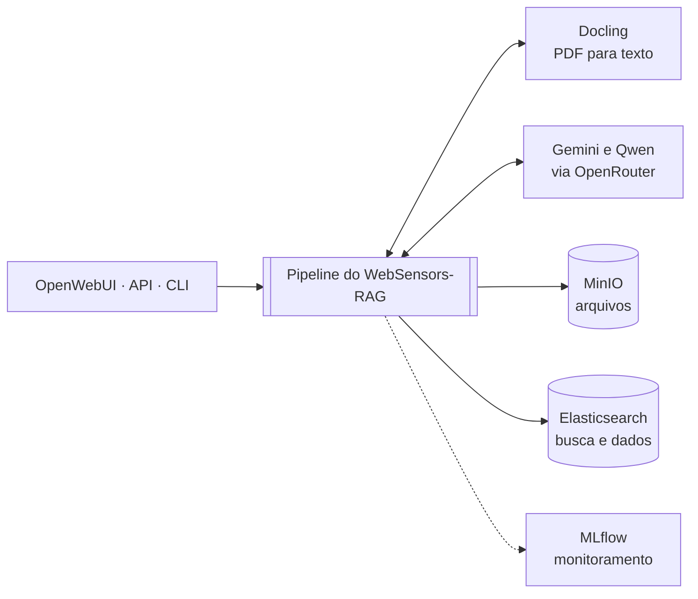
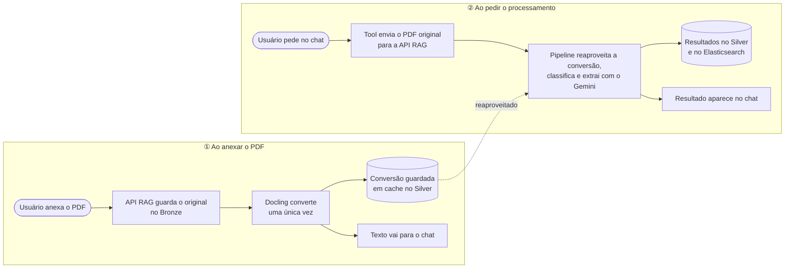
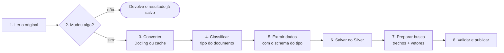
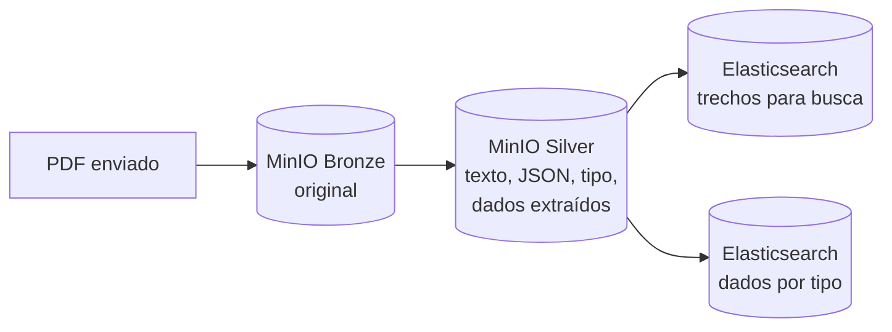

# Arquitetura

O WebSensors-RAG recebe documentos por três entradas (OpenWebUI, API e CLI) e
processa todos com **o mesmo pipeline**. O resultado é o tipo do documento, os
dados extraídos em JSON e o texto pronto para busca.

## 1. Visão geral

| Componente | Papel |
| --- | --- |
| **Docling** (local) | Converte o PDF em texto (Markdown) e estrutura (JSON), inclusive com OCR. |
| **Gemini** (OpenRouter) | Classifica o tipo do documento e extrai os dados. |
| **Qwen Embedding** (OpenRouter) | Gera os vetores usados na busca semântica. |
| **MinIO** | Guarda o PDF original (Bronze) e os resultados (Silver). |
| **Elasticsearch** | Guarda os trechos para busca e os dados extraídos por tipo. |
| **MLflow** | Registra cada execução: etapas, tempos e métricas. |

## 2. Fluxo pelo OpenWebUI

O uso pelo chat acontece em **dois momentos**:

1. **Ao anexar:** o OpenWebUI envia o PDF para a nossa API, que guarda o original e
   faz a conversão com o Docling. O resultado fica em cache e o texto vai para o chat.
2. **Ao pedir o processamento:** a Tool busca o PDF original e o envia para a API.
   O pipeline usa a conversão já feita (o Docling não roda de novo), classifica o
   documento, extrai os dados, salva tudo e devolve o resultado ao chat.

Pela **CLI** só existe o segundo momento: o comando envia o arquivo direto ao mesmo
pipeline e, se não houver cache, converte uma vez.

## 3. O pipeline

- **Mudou algo?** Compara o arquivo e a configuração (modelos, prompts, schemas)
  com o que já foi processado. Se nada mudou, não chama o Docling nem o Gemini.
- **Classificar:** o Gemini escolhe uma das categorias do projeto (edital, ficha
  de inscrição, CNH...). Se não reconhecer, usa `outro` e não faz extração.
- **Extrair:** cada tipo tem seu prompt e seu schema. Todo valor precisa de um
  trecho do documento como evidência; o modelo não pode inventar dados.
- **Validar e publicar:** a versão nova só passa a valer depois de conferida. Se
  algo falhar no meio, a versão anterior continua valendo.

No código, essas 8 etapas correspondem a 12 steps do WebSensors-Flow.

## 4. Onde os dados ficam

| Local | Conteúdo |
| --- | --- |
| `rag-bronze` | O PDF original, exatamente como foi enviado. |
| `rag-silver` | Por versão do documento: `document.md`, `document.json`, `classification.json`, `extraction.json` e `manifest.json`; além do cache da conversão do Docling. |
| `websensors-rag-chunks` | Trechos do texto com vetores, usados nas buscas BM25, semântica e híbrida. |
| `websensors-rag-documents` | Uma ficha por documento, apontando para a versão ativa. |
| `rag-estruturado-fai-<tipo>` | Os dados extraídos, um índice por tipo de documento (ex.: `rag-estruturado-fai-edital`). |

## 5. Versões do documento

Cada processamento que muda algo cria uma **nova versão** (revisão). Ela é
montada desativada e só é ativada depois de validada; nesse momento a versão
anterior é desativada. Se houver erro na troca, o sistema volta para a versão
anterior. Assim, a busca e os dados por tipo nunca ficam pela metade.

Mudar o arquivo, o modelo, um prompt ou um schema gera nova versão. A conversão
do Docling é reaproveitada sempre que o PDF é o mesmo.

## 6. Monitoramento

Cada execução aparece no MLflow (experimento `websensors-flow-rag`) com o tempo de
cada etapa, os modelos usados e métricas como acerto do JSON, número de campos
extraídos e conversões do Docling. Textos dos documentos, dados pessoais e chaves
não são gravados no MLflow.

## 7. Onde fica cada coisa no código

| Responsabilidade | Local |
| --- | --- |
| API (rotas HTTP) | `src/websensors_flow_rag/api.py` |
| Serviço comum (API e CLI) | `src/websensors_flow_rag/services/process_document.py` |
| Etapas do pipeline | `src/websensors_flow_rag/indexing/`, `classification/`, `extraction/`, `structured/` |
| Categorias, prompts e schemas | `projects/<projeto>/` ([como adicionar um tipo](novos_tipos_documentais.md)) |
| Tool do OpenWebUI | `integrations/openwebui/process_document_tool.py` |

Mais detalhes: [classificação](../resources/11_classificacao.md),
[extração](../resources/12_extracao.md) e
[índices por tipo](../resources/13_indices_estruturados.md).
